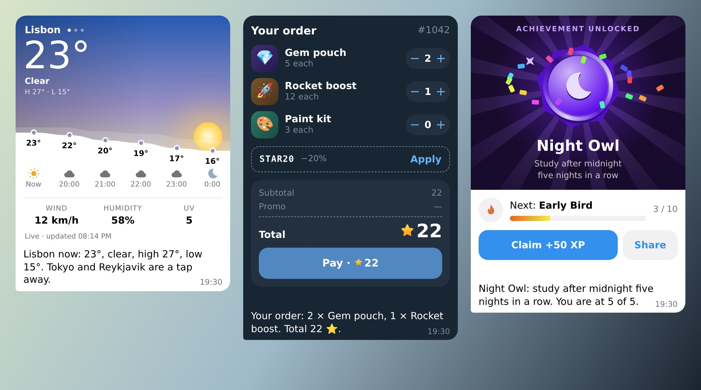

# Telegram bot widgets skill

An agent skill (Claude Code, or any agent that reads `SKILL.md`) for building
Telegram's **HTML widgets**: the small interactive blocks a bot can put inside
a message since Bot API 10.4 (`sendWidget`, `widget_query`,
`answerWidgetQuery`, `editMessageWidgetData`, the `TelegramWidget` object).

It condenses the official docs
([widgets guide](https://core.telegram.org/bots/widgets),
[Bot API](https://core.telegram.org/bots/api#sendwidget)) and adds what we
learned shipping widgets to real users: production limits, recording answers
reliably, fallbacks, packaging.

## Contents

```
SKILL.md                         entry point: workflow and the rules that bite
references/
  bot-api.md                     methods, parameters, updates, errors
  widget-runtime.md              TelegramWidget, events, CSS variables, sandbox limits
  design.md                      native look, sizes, gestures
  production-notes.md            lessons from production
  patterns.md                    patterns from the examples: motion, state, Stars, size
examples/
  quiz.html                      a quiz whose answers the bot records
  weather.html                   a living sky for a shared widget: one edit moves every message
  checkout.html                  a cart paid with Telegram Stars: cart, waiting, paid, failed
  achievement.html               a medal that unlocks live, with claim and share
  logic.mjs                      what the bot does with each request, shared by the bot and the preview
  bot.mjs                        a dependency-free Node bot: /quiz /weather /checkout /achievement
  check-size.mjs                 size check against Telegram's limits
  preview.mjs                    local preview with a stand-in TelegramWidget and the bot's answers
```



## Install

Claude Code:

```sh
git clone https://github.com/gulivan/telegram-bot-widgets-skill ~/.claude/skills/telegram-bot-widgets
```

Other agents: point them at `SKILL.md`.

## Try the examples

```sh
node examples/check-size.mjs examples/weather.html
node examples/preview.mjs examples/checkout.html      # sample order; the buttons on top switch states
node examples/preview.mjs examples/quiz.html '{"q":[{"h":"你好","p":"nǐ hǎo","o":["thank you","hello","goodbye"],"a":1}]}'
TELEGRAM_BOT_TOKEN=… node examples/bot.mjs            # then /quiz, /weather, /checkout or /achievement
```

`/checkout` takes real Telegram Stars and refunds them ten seconds later
(`KEEP_STARS=1` keeps them). Stars are for digital goods only. Paying takes two
taps: Pay in the widget, then Pay on the invoice the bot sends below it.

Widgets in production work only in the private chat with the bot, and every
widget message is protected content (no forwarding, phones block
screenshots). Groups, inline mode and forwards are on the test server only.

## License

MIT
